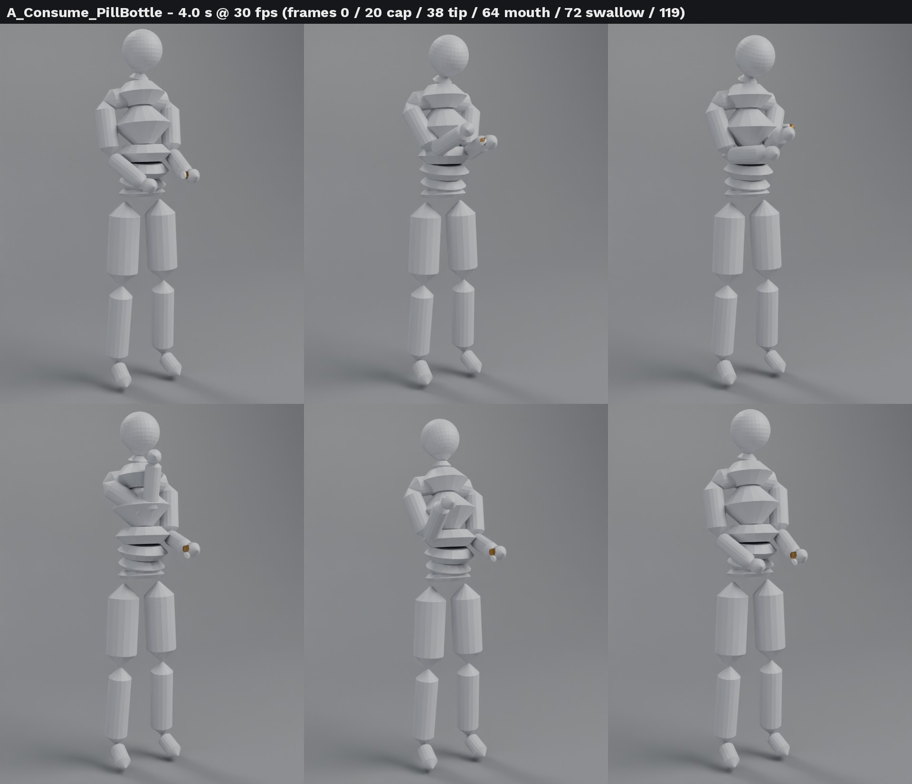

# A_Consume_PillBottle (sample clip)

A new consumable animation the game doesn't have yet: **pop a pill**.
4.0 s at 30 fps (120 frames):
1. hold
2. raise the bottle
3. right thumb flips the cap (frame 20)
4. tip two pills into the right palm (38)
5. palm to the mouth (64)
6. head back and swallow (72)
7. return to the hold

The first and last frames are identical.

| File | What |
|---|---|
| `out/A_Consume_PillBottle.fbx` | armature only, contract FBX settings (FBX_SCALE_NONE, -Y forward, Z up, no leaf bones, deform bones, baked), upper body keyed from spine_02 up |
| `out/A_Consume_PillBottle.events.json` | `UseItemStart` 20, `UseItemEnd` 88 |
| `out/A_Consume_PillBottle.targets.json` | per-frame world positions of hand_l / hand_r / head (UE cm), so the clip can be baked onto the real rig |
| `out/SM_PillBottle.fbx`, `out/SM_PillBottle_Cap.fbx` | prop: 3.4 × 7.4 cm amber bottle, flip cap hinged at the +Y rim; pivot = base centre |

**Rig caveat.** The rig is rebuilt from `props/brief/skeleton_ue5_manny_rest.json` (37 core bones, no fingers). That file only gives bone heads plus axis markers, not Epic's bone rolls. So this FBX is a review clip.

To use it in game:
1. Retarget it onto `Tools/Anim/template_fp.blend` by bone name, world-space match (the targets json carries the wrist and head paths).
2. Run the import pre-flight.
3. The Grip Workshop then adds fingers (thumb flick, palm cup).

Script: `pill_bottle_anim.py`. It has IK + pole keys, bakes to FK, and draws capsule proxies for the review renders.
